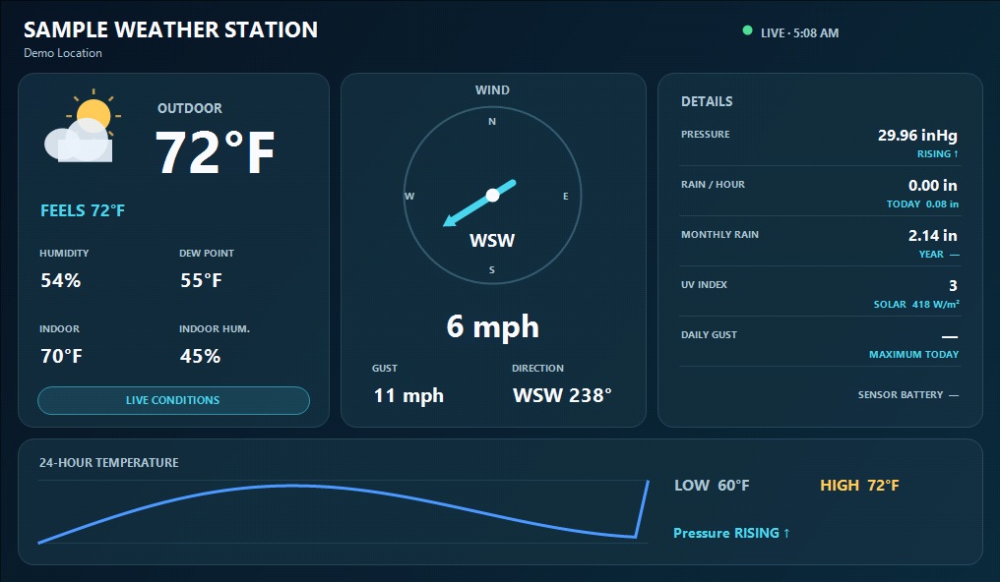
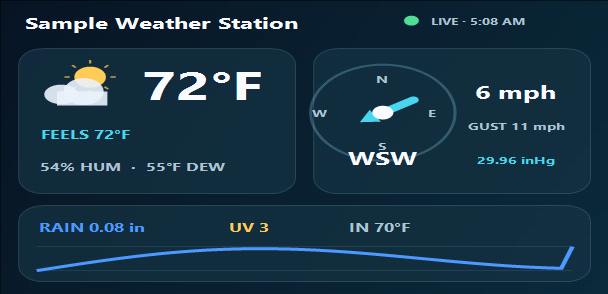
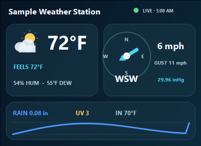
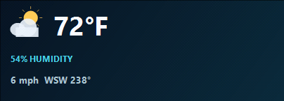
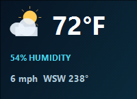

# Ambient Weather Station for G.SKILL WigiDash

[](https://github.com/MorangeR18/AmbientWeather-WigiDash/releases/latest)
[](https://github.com/MorangeR18/AmbientWeather-WigiDash/releases)
[](https://github.com/MorangeR18/AmbientWeather-WigiDash/actions/workflows/verify.yml)
[](LICENSE)

An unofficial, open-source widget that turns an Ambient Weather personal weather station into a live G.SKILL WigiDash touchscreen dashboard. Use the full 5×4 page or choose a compact layout for an existing dashboard.



*Rendered preview using synthetic station data; no real station identity, location, or credentials are shown.*

> [!IMPORTANT]
> This community project is not affiliated with or endorsed by G.SKILL or Ambient Weather. Every user supplies their own Ambient Weather API Key and Application Key; no shared credentials are included.

## Download and install

**Most users do not need Visual Studio or the source code.** Download the prepared widget package from the Releases page:

### [Download the latest release](https://github.com/MorangeR18/AmbientWeather-WigiDash/releases/latest)

Under **Assets**, download `AmbientWeather-WigiDash-v1.0.0.zip`—not GitHub's automatically generated “Source code” archives.

### Requirements

- A G.SKILL WigiDash with WigiDash Manager on Windows 10 or 11
- An AmbientWeather.net account with a reporting weather station
- Your own Ambient Weather **API Key** and **Application Key**

### Installation

1. Download and open `AmbientWeather-WigiDash-v1.0.0.zip`.
2. Close WigiDash Manager completely, including its notification-area icon.
3. Press <kbd>Win</kbd>+<kbd>R</kbd>, paste the following path, and select **OK**:

   ```text
   %APPDATA%\G.SKILL\WigiDashManager\Widgets
   ```

4. Copy the entire folder below from the ZIP into the `Widgets` folder:

   ```text
   7A2E4F11-3D92-4F65-9B23-C8B6D451A907
   ```

5. Start WigiDash Manager and find **Ambient Weather Station** in the widget list.
6. Create an empty page, select the **5×4** widget size, and drag the widget onto the page.

The custom widget does not belong in WigiDash Manager's protected `DefaultWidgets` directory under Program Files.

### Connect your weather station

1. Sign in to [AmbientWeather.net](https://ambientweather.net/) and open **Account**.
2. Create or copy both your **API Key** and **Application Key**. They are different values and both are required.
3. Select the widget in WigiDash Manager and open its settings.
4. Enter both keys and select **Test connection / load stations**.
5. Confirm the expected station appears, choose it, select your units and refresh interval, then select **Save and refresh**.

Tap the live widget once to request a manual refresh.

> [!CAUTION]
> Treat both keys as secrets. Never place them in source code, screenshots, commits, issue reports, videos, or unredacted logs.

## Features

- Outdoor temperature, feels-like temperature, humidity, and dew point
- Wind direction, speed, gust, and daily maximum gust when reported
- Relative barometric pressure with a rising, steady, or falling trend
- Hourly, daily, monthly, and yearly rainfall
- Indoor temperature and humidity when reported
- UV index and solar radiation when available
- Lightning or PM2.5 information when supported by attached sensors
- Current-inclusive 24-hour temperature graph with high and low readings
- Live/stale connection state and last successful update time
- Imperial or metric display units
- Full-page 5×4 plus 3×2, 2×2, 2×1, and 1×1 layouts
- Manual refresh by tapping the widget

Ambient Weather exposes station observations through this API, not a conventional weather forecast. The widget deliberately does not invent forecast conditions.

## Layout previews

All previews use synthetic sample station data.

| Full page — 5×4 |
| --- |
|  |

| Wide dashboard — 3×2 | Dashboard tile — 2×2 |
| --- | --- |
|  |  |

| Wide compact tile — 2×1 | Compact tile — 1×1 |
| --- | --- |
|  |  |

The WigiDash display is 1024×600. A full 5×4 widget receives 1016×592 pixels because WigiDash Manager reserves the grid margins.

## Compatibility

| Component | Status |
| --- | --- |
| Widget | Version 1.0.0 |
| WigiDash Manager | Developed and hardware-tested with 1.2.9559.29232 |
| Windows | Designed for Windows 10 and Windows 11 |
| Runtime target | .NET Framework 4.7.2 |
| WigiDash layout | 1×1, 2×1, 2×2, 3×2, and 5×4 |
| Ambient Weather API | `/v1/devices` current observations and device history |

Later WigiDash Manager versions may update the widget framework. If the widget stops appearing after a Manager update, open a bug report with the new Manager version.

## Refresh behavior and API limits

- Current observations refresh every **60 seconds** by default.
- The selectable live refresh interval is **30–300 seconds**.
- The 24-hour history refreshes every **15 minutes**.
- Requests are serialized with at least **1.1 seconds** between them.
- The freshest observation is added to the displayed graph and high/low calculation even between history refreshes.

Historical readings may lag the current observation because Ambient Weather stores history at a lower cadence. The widget uses the device-list endpoint for the freshest observation and device history only for trends.

## Credentials and privacy

- Each installation uses the owner's own API Key and Application Key.
- Keys and the selected station identifier are encrypted for the current Windows user with Windows DPAPI before WigiDash Manager stores the settings.
- Keys and the exact station identifier are redacted from widget error logs.
- Requests use HTTPS. Because Ambient Weather's API places credentials in the query string, trusted local HTTPS-inspection or proxy software may still record them.
- The project contains no analytics, telemetry, advertising, cloud relay, or third-party weather service.

To remove the local widget, close WigiDash Manager and delete only this folder, then restart Manager:

```text
%APPDATA%\G.SKILL\WigiDashManager\Widgets\7A2E4F11-3D92-4F65-9B23-C8B6D451A907
```

## Updating

1. Download the newer release ZIP.
2. Close WigiDash Manager completely.
3. Replace the existing GUID-named widget folder with the one from the new release.
4. Restart WigiDash Manager.

Your saved configuration is managed by WigiDash Manager and should remain available. Review the release notes for version-specific upgrade information.

## Troubleshooting

### The widget does not appear

1. Confirm WigiDash Manager was fully closed during installation.
2. Confirm the DLL is directly inside the GUID-named folder below `%APPDATA%\G.SKILL\WigiDashManager\Widgets`.
3. Confirm you did not place it under `DefaultWidgets`.
4. Restart Windows if Manager remained open in the background.
5. If Manager was recently updated, report its exact version in a GitHub issue.

### “Ambient Weather rejected the API credentials”

Re-copy both keys from the AmbientWeather.net account page. The API Key and Application Key are different values, and both are required.

### The dashboard says “STALE”

The last valid station data remains visible instead of blanking the page. Check internet connectivity and the station's AmbientWeather.net status. The widget retries automatically at the selected interval.

### A field shows an em dash

Ambient Weather stations and add-on sensors report different field sets. An em dash means the selected station did not provide that reading; it is not treated as zero.

### WigiDash Manager logs

Manager logs are normally under `%USERPROFILE%\AppData\Roaming\G.SKILL\WigiDashManager\Logs`. Redact credentials, exact station identifiers, MAC addresses, and location information before sharing anything from that directory.

## Verify a downloaded release

Each release includes a `.sha256` file. In PowerShell, calculate the ZIP's checksum:

```powershell
Get-FileHash -Algorithm SHA256 .\AmbientWeather-WigiDash-v1.0.0.zip
```

Compare the result with `AmbientWeather-WigiDash-v1.0.0.sha256` from the same release.

## Build from source

Source builds require:

- G.SKILL WigiDash Manager installed locally
- Visual Studio 2022 with **.NET desktop development**, or the .NET Framework compiler included with Windows

Open PowerShell in the project directory and run:

```powershell
.\scripts\Build.ps1 -Configuration Release
```

The ready-to-install development build is created at:

```text
artifacts\AmbientWeatherStation\7A2E4F11-3D92-4F65-9B23-C8B6D451A907.dll
```

Install that local build with:

```powershell
.\scripts\Install-Widget.ps1
```

The build references `WigiDashWidgetFramework.dll` supplied by the installed WigiDash Manager and never packages that framework. If Manager is installed elsewhere, provide its directory explicitly:

```powershell
.\scripts\Build.ps1 -WigiDashManagerPath 'D:\Apps\G.SKILL\WigiDash Manager'
```

## Test and package

Run the local verification suite:

```powershell
.\scripts\Test.ps1
```

It validates Ambient Weather JSON parsing, renders all five supported layouts, and verifies the Windows DPAPI round trip when a Windows user profile is available. Rendered previews are written to `artifacts\previews`.

Maintainers can build a release ZIP and checksum with:

```powershell
.\scripts\Package-Release.ps1 -Version 1.0.0
```

The packaging script verifies the tests and version, builds against the locally installed WigiDash framework, and writes release assets under `artifacts\release`.

## Project layout

```text
.github\                         Contribution forms and parser/rendering workflow
docs\                            Release instructions and publishable images
scripts\Build.ps1               Builds the native widget DLL
scripts\Install-Widget.ps1      Installs a local development build
scripts\Package-Release.ps1     Creates the release ZIP and SHA-256 file
scripts\Test.ps1                Runs parser, credential, and render checks
src\AmbientWeatherWidget\       Widget, settings UI, API client, and renderer
tools\Preview\                  Deterministic preview/self-test utility
```

## Contributing and support

- Read [CONTRIBUTING.md](CONTRIBUTING.md) before proposing a change.
- Read [SUPPORT.md](SUPPORT.md) to choose between Discussions, Issues, and private security reporting.
- Use the structured [bug report](https://github.com/MorangeR18/AmbientWeather-WigiDash/issues/new?template=bug_report.yml) or [feature request](https://github.com/MorangeR18/AmbientWeather-WigiDash/issues/new?template=feature_request.yml).
- Review [SECURITY.md](SECURITY.md) before reporting a vulnerability or sharing diagnostic information.
- See [CHANGELOG.md](CHANGELOG.md) for release history.

## License

Original project code and documentation are available under the [MIT License](LICENSE). You may use, copy, modify, publish, distribute, sublicense, and sell copies subject to the license's notice requirement.

The repository does not redistribute WigiDash Manager binaries, copied WigiDash SDK source, or Ambient Weather API documentation. Product names and trademarks belong to their respective owners. See [THIRD_PARTY_NOTICES.md](THIRD_PARTY_NOTICES.md).

## Upstream references

- [G.SKILL WigiDash product and specifications](https://www.gskill.com/product/412/415/1702982997/WigiDash)
- [Official WigiDash widget SDK repositories](https://github.com/orgs/ElmorLabs-WigiDash/repositories)
- [Ambient Weather API documentation](https://github.com/ambient-weather/api-docs)
- [Ambient Weather device field reference](https://github.com/ambient-weather/api-docs/wiki/Device-Data-Specs)
